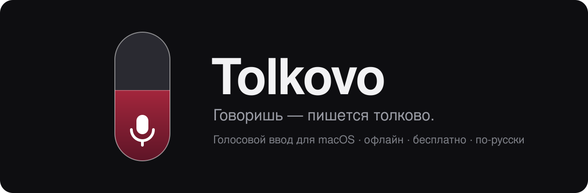
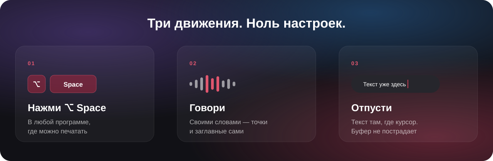
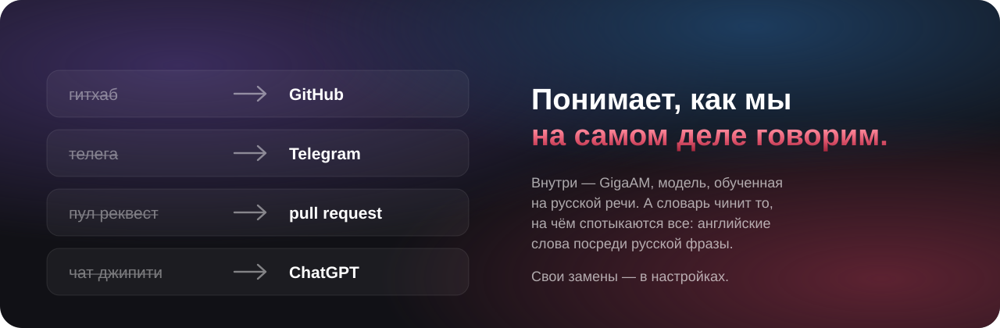
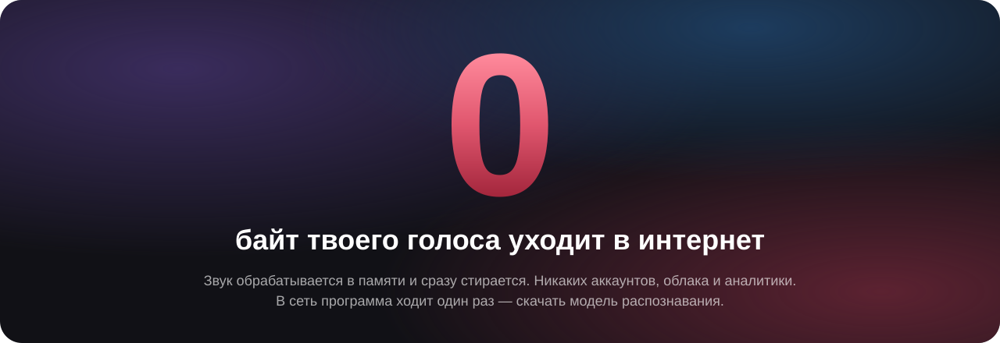
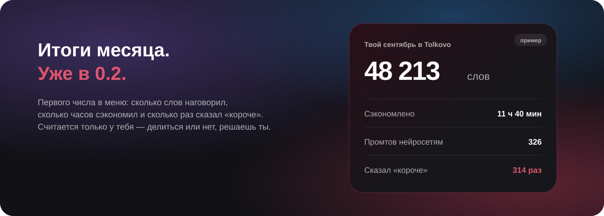

<p align="center">
  <picture>
    <source media="(prefers-color-scheme: dark)" srcset=".github/assets/banner-dark.svg">
    <source media="(prefers-color-scheme: light)" srcset=".github/assets/banner-light.svg">
    
  </picture>
</p>

<p align="center">
  <a href="https://github.com/kozliq/Tolkovo/releases/latest"></a>
  <a href="https://github.com/kozliq/Tolkovo/releases"></a>
  
  <a href="LICENSE"></a>
</p>

<h3 align="center">Нажал <kbd>⌥ Space</kbd>, сказал — текст уже там, где курсор.</h3>

<p align="center">
  В Telegram, в браузере, в ChatGPT и Claude. Без интернета, по-русски, бесплатно навсегда.
</p>

<p align="center">
  <a href="https://github.com/kozliq/Tolkovo/releases/latest"><b>⬇ Скачать для Mac</b></a>
  &nbsp;·&nbsp;
  <a href="#установка">Установка</a>
  &nbsp;·&nbsp;
  <a href="#приватность">Приватность</a>
  &nbsp;·&nbsp;
  <a href="#вопросы">Вопросы</a>
  &nbsp;·&nbsp;
  <a href="#english">English</a>
</p>

<br>

<p align="center">
  
</p>

<br>

<p align="center">
  
</p>

<p align="center">
  
</p>

<p align="center">
  
</p>

## Приватность

<p align="center">
  
</p>

Звук обрабатывается в памяти и сразу стирается. Ни звук, ни текст никуда не отправляются. Нет аккаунтов, телеметрии, аналитики и облака — программа ничего о тебе не собирает. Единственное обращение в сеть за всё время: один раз скачать модель распознавания.

Разрешение «Универсальный доступ» нужно ровно для одного действия — нажать «вставить» за тебя в активном окне. Tolkovo не читает, что ты печатаешь, и не видит содержимое других программ.

**Не верь на слово — проверь.** Код открыт, а каждый релиз собирается на серверах GitHub прямо из этого репозитория и подтверждается криптографической подписью происхождения:

```bash
gh attestation verify Tolkovo.dmg --repo kozliq/Tolkovo
```

## Установка

1. Скачай **[Tolkovo.dmg](https://github.com/kozliq/Tolkovo/releases/latest)** и перетащи значок в «Программы».
2. Один раз выполни в Терминале:
   ```bash
   xattr -dr com.apple.quarantine /Applications/Tolkovo.app
   ```
   Программа пока не подписана платным сертификатом Apple. Команда снимает пометку «скачано из интернета» — после этого macOS запускает её как обычно.
3. Открой Tolkovo, разреши микрофон и вставку текста. Модель скачается сама — и можно говорить.

Нужен Mac на Apple Silicon (M1 и новее) с macOS 14 или свежее.

## Что дальше

<p align="center">
  
</p>

- [x] Распознавание русской речи прямо на Mac
- [x] Работа в любом приложении
- [ ] Первый запуск без единой настройки и стеклянная пилюля
- [ ] Личный словарь англицизмов
- [ ] Живой текст — слова видно прямо во время речи
- [ ] Голосовые команды: «новая строка», «точка»
- [ ] «Итоги месяца» — всё считается только у тебя

Есть идея или нашёл баг — [открой issue](https://github.com/kozliq/Tolkovo/issues/new/choose).

## Вопросы

<details>
<summary><b>Правда бесплатно? Где подвох?</b></summary>
<br>
Подвоха нет. Программа работает на твоём компьютере, серверов у проекта нет — брать деньги не за что. Никакие функции никогда не станут платными. Если хочется сказать спасибо — есть <a href="DONATE.md">добровольная поддержка</a>, но она ни на что не влияет.
</details>

<details>
<summary><b>Нужен ли интернет?</b></summary>
<br>
Только один раз — чтобы скачать модель. Дальше можно хоть в самолёте.
</details>

<details>
<summary><b>А английские слова понимает?</b></summary>
<br>
Модель заточена под русский, поэтому английские слова иногда пишет по-русски. Для этого есть словарь: «гитхаб» сам станет GitHub. Свои замены добавляются в настройках.
</details>

<details>
<summary><b>Будет версия для Windows?</b></summary>
<br>
Ядро кроссплатформенное, так что технически это возможно. Сейчас главное — сделать идеальную версию для Mac.
</details>

<details>
<summary><b>На чём это сделано?</b></summary>
<br>
Tolkovo — форк открытого проекта <a href="https://github.com/cjpais/Handy">Handy</a> от CJ Pais. От него — надёжное ядро записи и распознавания, от нас — всё, что ты видишь и трогаешь.
</details>

## Кто делает

Меня зовут **kozliq**. Я не программист из Кремниевой долины — я парень из Омска, который захотел, чтобы печатать голосом было так же просто, как говорить. Tolkovo я собираю вместе с Claude: GitHub и нейросети у нас те же, что у ребят из Сан-Франциско, а остальное — упорство.

Следить за разработкой: [Telegram-канал](ССЫЛКА_НА_КАНАЛ)

## Поддержать

Tolkovo бесплатный и таким останется. Больше всего помогает ⭐ этому репозиторию и рассказ друзьям. А если хочется поблагодарить иначе — [страница поддержки](DONATE.md).

## Благодарности

Tolkovo — форк **[Handy](https://github.com/cjpais/Handy)** от CJ Pais: всё ядро записи, распознавания и вставки текста сделано ими, и без их открытого кода этого проекта бы не было. Если нужна англоязычная кроссплатформенная версия — иди к ним.

Спасибо командам **GigaAM** (SberDevices) за открытую русскую модель, **transcribe.cpp**, **Tauri** и **Anthropic** за Claude, с которым написан этот проект.

## Лицензия

[MIT](LICENSE). Копирайт оригинального Handy сохранён, как того требует лицензия.

---

<a name="english"></a>
<details>
<summary><b>English</b></summary>
<br>

**Tolkovo** is a free, offline, privacy-first voice typing app for macOS, made for Russian speakers. Press <kbd>⌥ Space</kbd>, speak, and the text appears wherever your cursor is. Runs GigaAM v3 locally — a model trained on Russian speech. No cloud, no telemetry, no accounts.

Made by kozliq from Omsk, together with Claude. A fork of the excellent [Handy](https://github.com/cjpais/Handy) — for the original cross-platform, English-first experience, go there.
</details>

<p align="center">
  <a href="https://www.star-history.com/#kozliq/Tolkovo&Date">
    <picture>
      <source media="(prefers-color-scheme: dark)" srcset="https://api.star-history.com/svg?repos=kozliq/Tolkovo&type=Date&theme=dark">
      
    </picture>
  </a>
</p>
